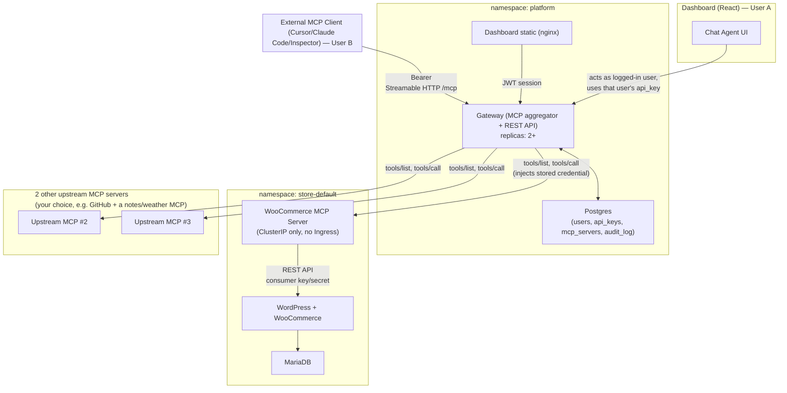

# UrmiAi — MCP Gateway on Kubernetes — Architecture Plan

Source: `requirment.txt` (Urumi AI FDE Internship, Round 1)

## 0. Decisions (lock these before coding)

| Area | Choice | Why |
|---|---|---|
| Gateway + MCP SDK | Node.js 20 + TypeScript, `@modelcontextprotocol/sdk` | Best Streamable-HTTP MCP support, same language as WooCommerce MCP server and dashboard → shared types |
| WooCommerce MCP server | Node.js + TS, `@modelcontextprotocol/sdk` server, calls WooCommerce REST API via `axios` + consumer key/secret | Requirement forbids installing an existing WC-MCP plugin; REST API is official, stable, auth is just key+secret in a header (vs WP-CLI which needs shell exec into the WP pod — fragile, needs extra RBAC) |
| Dashboard | React + Vite + TS, TanStack Query, shadcn/ui, served by nginx | Fast to build, static bundle ships easily as its own Deployment |
| Gateway DB | PostgreSQL (StatefulSet) | users, api_keys, mcp_servers, audit_log, chat_sessions |
| Store DB | MariaDB (StatefulSet) | WordPress default |
| Store | WordPress official image + WooCommerce plugin baked in via custom Dockerfile + one-shot `wp-cli` Job for install/activate/REST-key creation | Deterministic, idempotent, no manual admin clicking |
| Ingress | ingress-nginx | Same chart local (Kind/k3d) and prod (k3s) |
| Local domains | `*.urmiai.local` via `/etc/hosts` + Kind extraPortMappings or `k3d` loadbalancer | documented in README |
| Secrets | K8s Secrets, values-prod.yaml secrets injected at `helm install --set-file`/CI, never committed | repo stays clean |
| Credential-at-rest encryption | AES-256-GCM, app-level, key = `GATEWAY_KEK` env from a Secret | upstream MCP server credentials must be usable (decrypt-and-forward), so hashing alone isn't enough — only for these; API keys ARE hashed (argon2), gateway only verifies them |
| Dashboard session auth | JWT (separate from gateway API keys) | dashboard users log in with email/password; gateway API keys are a *different* credential for programmatic/MCP-client/chat-agent access |
| Chat agent LLM | Any OpenAI-compatible `/chat/completions` endpoint. Local default is OpenAI (`api.openai.com/v1`, model `gpt-4.1-mini`). Gemini, Groq, or Ollama is the same three env vars. | grading is on tool-loop correctness, not model quality |

---

## 1. System diagram



---

## 2. Repo layout

```
UrmiAi/
  helm/
    urmiai/                     # umbrella chart
      Chart.yaml                # dependencies: store, woocommerce-mcp, gateway, dashboard
      values.yaml                # shared defaults
      values-local.yaml          # Kind/k3d overrides (local domains, hostPath/local-path SC, small resources)
      values-prod.yaml           # k3s/VPS overrides (real domains, cert-manager, storageClass, resources)
      charts/
        store/                   # mariadb + wordpress + init Job + Ingress
        woocommerce-mcp/         # Deployment + Service (ClusterIP)
        gateway/                 # Deployment + Service + Ingress + Postgres subchart
        dashboard/               # Deployment + Service (Ingress path shared with gateway)
  services/
    woocommerce-mcp-server/      # TS, MCP server
    gateway/                     # TS, Express/Fastify + MCP server + MCP client manager
    dashboard/                   # React
  docs/
    architecture.md              # this file
    system-design-tradeoffs.md
    threat-model.md
  README.md
```

One umbrella Helm chart with 4 subcharts = satisfies "Helm is mandatory", "same charts local→prod via values files", and keeps the bonus (multi-store) clean: provisioning = `helm install store-<slug> ./charts/store -f values-store.yaml --namespace store-<slug>` triggered by the gateway's provisioning service.

---

## 3. Kubernetes resource plan

### Namespace: `store-<slug>` (default: `store-default`)
| Resource | Kind | Notes |
|---|---|---|
| mariadb | StatefulSet + PVC + Secret + Service(ClusterIP) | liveness/readiness: `mysqladmin ping` |
| wordpress | Deployment + PVC(wp-content) + Secret + Service(ClusterIP) | readiness: `GET /wp-login.php`; Ingress: `store.urmiai.local` → this Service only |
| wp-init Job | Job (Helm hook `post-install,post-upgrade`) | idempotent: installs WP core, activates WooCommerce, creates REST consumer key/secret, writes it to a Secret the mcp server reads |
| woocommerce-mcp | Deployment + Secret(WC key/secret, store base URL) + Service(ClusterIP) | **no Ingress** — "not reachable from outside the cluster"; readiness `GET /healthz` |
| NetworkPolicy (bonus/isolation) | deny-by-default + allow gateway→mcp, wordpress→mariadb, wp-init→wordpress/mariadb | enforces "only the gateway can call it" |

### Namespace: `platform`
| Resource | Kind | Notes |
|---|---|---|
| postgres | StatefulSet + PVC + Secret | readiness `pg_isready` |
| gateway | Deployment (replicas configurable, 2 for scaling bonus) + Secret(KEK, JWT secret, LLM key) + Service | readiness `GET /healthz` (checks PG); liveness `GET /livez` |
| dashboard | Deployment + Service (nginx serving built SPA) | readiness `GET /` |
| Ingress | one Ingress, host `app.urmiai.local`: `/` → dashboard, `/api` + `/mcp` → gateway | avoids CORS, single stable URL per environment |

All Deployments/StatefulSets: `resources.requests/limits` for CPU+memory set in values.yaml (overridable per env — local gets tiny, prod gets real).

---

## 4. MCP Gateway internals

### 4.1 Registry model (Postgres)
```
users(id, email, password_hash, role[admin|member], created_at)
api_keys(id, user_id, key_hash, label, revoked_at, created_at, last_used_at)
mcp_servers(id, slug, name, base_url, auth_type[none|header|bearer],
            auth_header_name, encrypted_credential, enabled, status, last_checked_at, owner_store_id?)
audit_log(id, user_id, server_slug, tool_name, started_at, duration_ms, success, error_message)
```

### 4.2 Tool name collision scheme
Every tool exposed by the gateway is renamed `"<server_slug>__<tool_name>"` (double underscore, slug set at registration, unique, `[a-z0-9-]+`). Documented, deterministic, and the gateway strips the prefix before forwarding `tools/call` to the matched upstream. This is the scheme to describe in the README/system-design doc.

### 4.3 tools/list aggregation
- Gateway holds a pool of persistent MCP clients (one per enabled upstream, Streamable HTTP transport).
- On `tools/list`: fan out to all enabled upstreams in parallel with a per-upstream timeout (e.g. 4s) via `Promise.allSettled` + `AbortController`.
- Failures are swallowed per-upstream (logged, server marked `Unreachable`), not thrown — "a slow or dead upstream must not break tool listing".
- Results merged, prefixed, cached ~5s to avoid hammering upstreams on every list call.
- Background health loop (every 15s) pings each enabled upstream's `tools/list`, updates `mcp_servers.status` → drives the dashboard's Connected/Unreachable/Disabled badge.

### 4.4 tools/call routing
1. Authenticate request: `Authorization: Bearer <api_key>` → look up `api_keys.key_hash` (argon2 verify) → resolve `user_id`, check not revoked.
2. Parse `<server_slug>__<tool_name>`, look up enabled server by slug (404/clear MCP error if disabled/missing — "tools disappear ... and rejected if called").
3. Decrypt stored credential (AES-GCM with `GATEWAY_KEK`), attach as header/bearer to the outbound call — **never sent to the client**.
4. Call upstream `tools/call` with timeout (e.g. 15s), AbortController.
5. Write `audit_log` row (user, server, tool, duration, success/error) regardless of outcome.
6. Return MCP-shaped result/error to caller.

### 4.5 SSRF guardrail (stand-out #6)
When admin adds a server by URL: resolve DNS, reject RFC1918/loopback/link-local ranges and the cloud metadata IP (`169.254.169.254`) unless an explicit allowlist flag is set for local dev.

---

## 5. Chat agent

- Dashboard's chat panel → `POST /api/chat` on the gateway service, carrying the **user's own dashboard JWT**.
- Gateway maps JWT → that user's `api_key` (each user has exactly one "primary" key auto-issued at signup, separate from any extra keys they generate for external clients) — this is how it "acts as the logged-in user" and shows in the audit log under them.
- Loop: send conversation + the gateway's own aggregated tool list (self-call to its own `/mcp` tools/list) to the LLM in OpenAI tool-calling format → if `tool_calls` returned, execute each via the gateway's own `tools/call` path (in-process, same code path as an external caller) → append results → repeat until final text → stream via SSE to the UI, surfacing each tool call + result in the transcript ("shows which tools it called").

---

## 6. Helm values split (local vs prod)

| Key | values-local.yaml | values-prod.yaml |
|---|---|---|
| `global.domain` | `urmiai.local` | real domain |
| `ingress.className` | `nginx` (Kind w/ ingress-nginx) | `nginx` + `cert-manager.io/cluster-issuer` annotation |
| `*.persistence.storageClass` | `standard` (Kind) / `local-path` (k3d) | `local-path` (k3s) or cloud SC |
| `*.resources` | small (e.g. 100m/128Mi) | real (e.g. 500m/512Mi) |
| `gateway.replicaCount` | 1 | 2+ |
| secrets | dummy/dev values, fine to commit as placeholders | referenced only, real values via `--set-file`/CI secret injection, never committed |
| TLS | off | on via cert-manager |

---

## 7. Build order (2 weeks, core first)

1. **Day 1–2**: Kind cluster + ingress-nginx; umbrella Helm skeleton; MariaDB+WordPress+init Job chart; storefront reachable at `store.urmiai.local`, manual checkout works.
2. **Day 3–4**: WooCommerce MCP server (list/create products, list/get orders, update order status) against REST API; deploy ClusterIP-only; test with MCP Inspector port-forwarded.
3. **Day 5–7**: Gateway core — Postgres schema, api key issuance/hashing, admin add-server CRUD, MCP client manager, tools/list aggregation + prefixing, tools/call routing + audit log, health loop.
4. **Day 8**: Register 2 extra public MCP servers (e.g. a GitHub MCP + a simple custom notes/weather MCP) to satisfy "three upstream servers".
5. **Day 9–10**: Dashboard — login, server list w/ status, add/edit/disable server, API key management, audit log table.
6. **Day 11**: Chat agent — tool loop + SSE + transcript UI.
7. **Day 12**: Full definition-of-done run-through with two real users (A dashboard, B external client); fix gaps (revoke key, disable server, kill pod scenarios).
8. **Day 13**: Helm values-prod.yaml, deploy to a k3s VPS, verify same charts work; probes/limits pass.
9. **Day 14**: README, system-design-tradeoffs.md, threat-model.md, demo video. Buffer for one bonus item (tool permissions is the cheapest high-value one) if time remains.

---

## 8. Threat model (seed — expand in `docs/threat-model.md`)

- **Shared upstream credential**: a member never sees `mcp_servers.encrypted_credential`; they can only invoke tools the server exposes, scoped by whatever permissions the credential itself has upstream (e.g. a WooCommerce key with order/product scope only) — document this as the real boundary, not the gateway.
- **Client tokens not passed through**: the gateway terminates the client's `api_key` auth at its own boundary and attaches a *different*, server-held credential outbound — two independent trust domains, so a leaked upstream credential can't be reconstructed from a client-side key and vice versa.
- **Untrusted upstream tool descriptions**: treat all upstream `tools/list` output as untrusted text handed to the LLM; strip/flag prompt-injection patterns, never auto-execute a tool the user/admin didn't explicitly enable, and show raw tool descriptions in the dashboard for admin review before enabling a new server.
- **User-to-user isolation**: API keys are per-user and hashed; audit log is keyed by `user_id`; role check (`admin` vs `member`) gates server CRUD and member management endpoints server-side, not just hidden in the UI.
